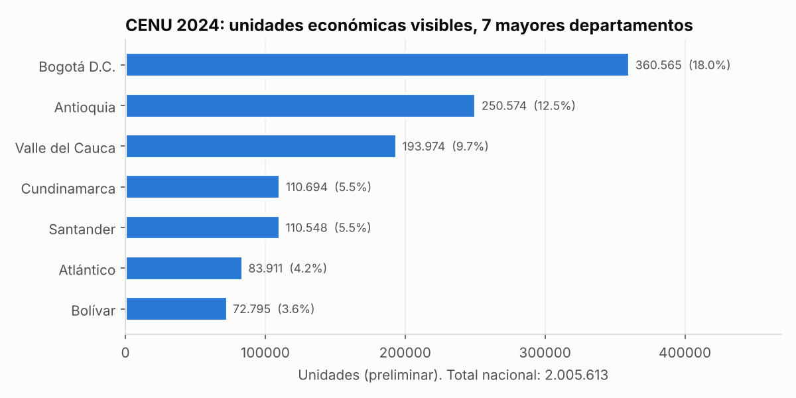
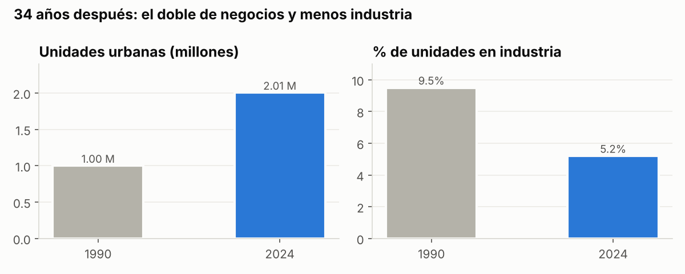
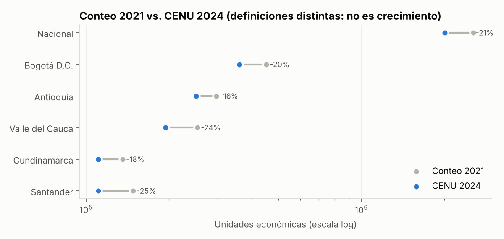
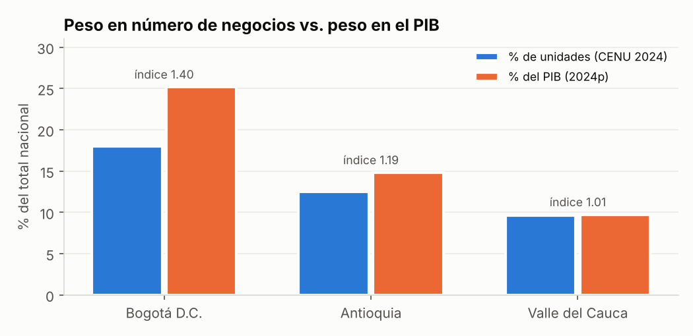
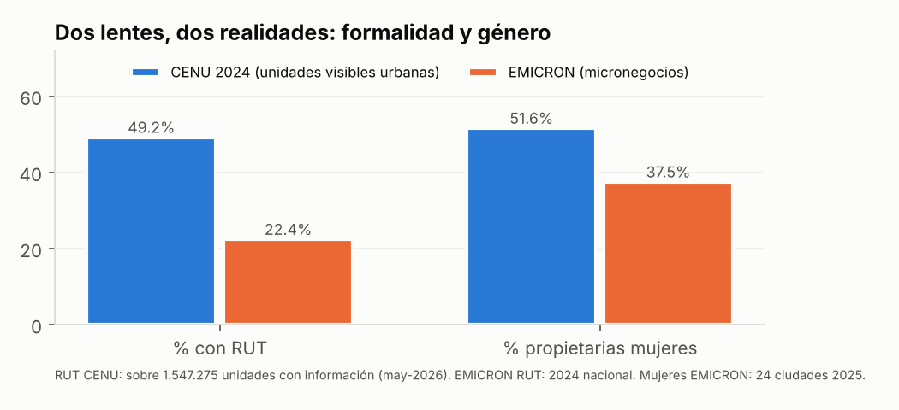
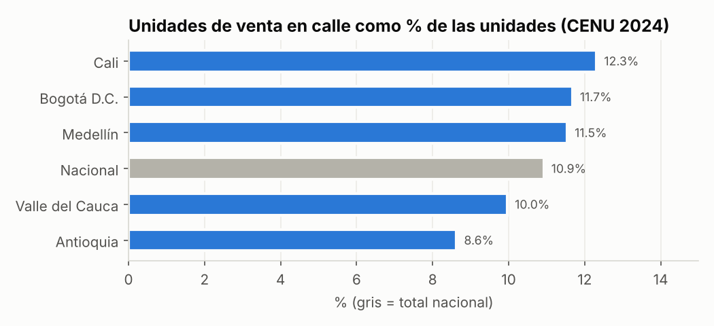

# 04 · Análisis profundo: qué dicen (y qué no dicen) los datos del CENU 2024

> Basado en cifras **publicadas** (preliminares) del CENU 2024 y en operaciones relacionadas: Conteo 2021, EMICRON, GEIH, PIB departamental y Censo 1990.
> Todas las cifras están en `data/cifras_oficiales/*.csv` con su URL de fuente. Varias vienen de prensa que cita al DANE, así que conviene verificarlas contra el boletín oficial antes de publicarlas.
> Las gráficas y la tabla [`docs/tablas/indicadores_territoriales.csv`](tablas/indicadores_territoriales.csv) se regeneran con `python scripts/analisis_cifras_oficiales.py`.

---

## Resumen ejecutivo: 10 hallazgos para el pitch

1. **Colombia urbana tiene ~2,0 millones de unidades económicas visibles** (2.005.613). Es el primer censo económico en 34 años: el de 1990 contó 1.001.398, así que en ese lapso el número de unidades se duplicó.
2. **Es una economía de comercio.** El comercio representa el 53,1 % de las unidades, los servicios el 32,3 % y la industria apenas el 5,2 % (en 1990 la industria era el 9,5 %). En 34 años el tejido urbano se desindustrializó.
3. **La concentración es moderada.** Bogotá tiene el 18 % de las unidades, y los 30 municipios más grandes suman el 57,2 %. El 42,8 % restante está repartido en más de 1.000 municipios, lo que hace del CENU la primera foto real de la economía de las **ciudades intermedias y pequeñas**.
4. **Bogotá produce más por negocio.** Tiene el 18,0 % de las unidades pero el 25,2 % del PIB (índice 1,40); Antioquia, 1,19; Valle, 1,01. Ver ⚠️ más abajo.
5. **1 de cada 10 unidades vende en la calle** (219.042, el 10,9 %). Cali (12,3 %), Bogotá (11,7 %) y Medellín (11,5 %) superan el promedio nacional, mientras Antioquia como departamento queda por debajo (8,6 %). La venta en calle es un fenómeno de **grandes ciudades**.
6. **La formalidad está partida a la mitad.** Entre las unidades con información, el 49,2 % tiene RUT y el 37,3 % no. San Andrés lidera, con 70 % de RUT y 75 % de registro mercantil.
7. **Las unidades visibles son mucho más formales que el universo de micronegocios.** Con RUT: 49 % en el CENU frente a 22 % en EMICRON. La diferencia muestra que lo **invisible** (negocios dentro de la vivienda, puerta a puerta o rurales) es donde se concentra la informalidad.
8. **Hay más mujeres propietarias que hombres entre las unidades visibles:** 51,6 % (613.953 frente a 576.983). En EMICRON las mujeres son apenas el 37,5 %. Hipótesis: los negocios visibles de barrio (tiendas, peluquerías, comidas) tienen alta propiedad femenina, mientras el universo EMICRON incluye transporte, construcción y agro, con mayoría masculina.
9. **El Conteo 2021 encontró 2,55 M unidades y el CENU 2,0 M (−21 %).** No es una caída de la economía: el CENU usa el criterio de "unidad visible" y otro protocolo. Es un ejemplo de manual de **por qué hay que leer la metodología antes de comparar**.
10. **La informalidad laboral urbana sigue alta:** 42,0 % en 23 ciudades (jun–ago 2026), con un rango que va de 34,1 % en Bogotá a 65,4 % en Sincelejo. En las microempresas llega a 85,1 %. El CENU permite por primera vez **ubicar en el mapa** dónde están esas unidades.

---

## 1. Estructura y escala

| Territorio | Unidades CENU 2024 | % nacional | Vendedores de calle | % calle |
|---|---:|---:|---:|---:|
| **Nacional** | 2.005.613 | 100 | 219.042 | 10,9 |
| Bogotá D.C. | 360.565 | 18,0 | 42.097 | 11,7 |
| Antioquia | 250.574 | 12,5 | 21.617 | 8,6 |
| Valle del Cauca | 193.974 | 9,7 | 19.326 | 10,0 |
| Cundinamarca | 110.694 | 5,5 | n.d. | – |
| Santander | 110.548 | 5,5 | n.d. | – |
| Atlántico | 83.911 | 4,2 | n.d. | – |
| Bolívar | 72.795 | 3,6 | n.d. | – |
| Medellín | 118.679 | 5,9 | 13.692 | 11,5 |
| Cali | 99.208 | 4,9 | 12.213 | 12,3 |
| Bucaramanga | 52.065 | 2,6 | n.d. | – |

**Lectura:** Cundinamarca casi iguala a Santander en número de unidades. Es la huella de la **sabana de Bogotá** (Soacha, Chía, Funza, Mosquera, Zipaquirá), una economía periurbana que el CENU mide por primera vez de forma completa.

## 2. 1990 → 2024: el doble de negocios y menos industria

| Indicador | 1990 | 2024 | Cambio |
|---|---:|---:|---:|
| Unidades urbanas | 1.001.398 | 2.005.613 | ×2,0 |
| Personas ocupadas / puestos | 3.932.823 | >9,5 M de puestos (prensa) | ×≈2,4 (no comparable 1:1) |
| % de unidades en industria | 9,5 % | 5,2 % | −4,3 p.p. |

Advertencia: en 1990 no se incluyó la venta en calle y los criterios de cobertura sectorial eran distintos.

## 3. Conteo 2021 vs CENU 2024: una lección de metodología

Todos los territorios muestran entre −16 % y −25 % de unidades frente al conteo de 2021. Que la caída sea **parecida en todas partes** sugiere un **efecto de definición** (unidad visible, depuración de viviendas sin actividad visible, protocolos de barrido) y no un choque económico. En el conteo 2021 las viviendas con actividad eran el 9,4 % y los puestos móviles el 4,1 %.

**Ángulo para el reto:** hay que explicar con claridad *qué* cuenta el CENU (unidades **visibles**) y *qué no* (negocios dentro de la vivienda sin aviso, negocios digitales, venta por catálogo), y proponer cómo complementarlo con EMICRON y con registros administrativos (RUES, DIAN).

## 4. Productividad territorial (aproximada)

`índice = % del PIB departamental / % de unidades CENU`

| Territorio | % unidades | % PIB 2024p | Índice | PIB por unidad (millones COP) |
|---|---:|---:|---:|---:|
| Bogotá | 18,0 | 25,2 | **1,40** | 1.193 |
| Antioquia | 12,5 | 14,8 | 1,19 | 1.011 |
| Valle | 9,7 | 9,7 | 1,01 | 858 |
| Nacional | 100 | 100 | 1,00 | 851 |

⚠️ El PIB incluye minería, agro, gobierno y zonas rurales, que el CENU no cubre. Este índice sirve para **ordenar** territorios, pero no mide la productividad de cada negocio. Con los microdatos del CENU (ingresos 2023 por unidad) se puede calcular el indicador correcto: **ingresos por unidad y por puesto de trabajo, por municipio y sector**.

## 5. Formalidad y género: dos lentes sobre la misma economía

| Indicador | CENU 2024 (visibles urbanas) | EMICRON (micronegocios) |
|---|---:|---:|
| % con RUT | 49,2 % (sobre 1,55 M con información) | 22,4 % (2024, nacional); 29,6 % en cabeceras |
| % sin registro mercantil | ~52,5 % (no confirmado) | 89,5 % |
| % propietarias mujeres | 51,6 % (sobre el 59,4 % con información) | 37,5 % (24 ciudades, 2025) |
| Universo | 2,0 M unidades visibles | 5,3 M micronegocios (incluye rural y no visibles) |

**Insight:** si se resta, unas 3 millones de unidades productivas pequeñas **no son visibles desde la calle**, y allí la formalidad es mucho menor. Una política de formalización que se apoye solo en el CENU llega a la mitad "fácil" del problema.

⚠️ El 59,4 % de cobertura sociodemográfica puede introducir sesgo (por ejemplo, que respondan más los negocios atendidos por su dueña o dueño). Hay que tratarlo como un **problema de no respuesta** y probar el resultado con ponderación por sector y municipio.

## 6. Venta en calle

- Son 219.042 unidades, presentes en unos 990 municipios.
- EMICRON 2024 estima **507.266 micronegocios de vendedores ambulantes**, más del doble. De nuevo aparece la brecha entre visible e invisible: muchos vendedores son itinerantes y no estaban en el punto al momento del barrido.
- Ideas de uso: gestión del espacio público, ferias temporales, inclusión financiera con pagos QR y seguros de bajo costo (ver `05_ideas_negocio.md`).

## 7. Informalidad laboral por ciudad (GEIH jun–ago 2026)

| Dominio | % ocupados informales |
|---|---:|
| Nacional | 54,8 |
| 23 ciudades AM | 42,0 |
| 13 ciudades AM | 40,7 |
| Sincelejo (máx.) | 65,4 |
| Cúcuta AM | 62,4 |
| Riohacha | 61,6 |
| Manizales AM | 35,3 |
| Tunja | 34,7 |
| Bogotá (mín.) | 34,1 |
| Microempresas | 85,1 |

**Cruce sugerido para el reto:** municipio × (% de unidades sin RUT según el CENU) × (tasa de informalidad laboral GEIH) × (densidad de unidades por 1.000 habitantes). El resultado sería una **tipología de ciudades**, por ejemplo: "muchas unidades y alta informalidad" en Sincelejo y Cúcuta frente a "pocas unidades por habitante y baja informalidad" en Bogotá y Tunja.

---

## 8. Plan de análisis cuando lleguen los microdatos o tablas del reto

| # | Pregunta | Método | Herramienta en el repo |
|---|---|---|---|
| 1 | ¿Cuál es la estructura sectorial por municipio? | Conteos y % por sección/división CIIU | `indicators.conteo_por` |
| 2 | ¿En qué se especializa cada ciudad? | Cociente de localización (LQ) | `indicators.cociente_localizacion` |
| 3 | ¿Qué economías locales son frágiles por concentración? | HHI y entropía de Shannon | `indicators.hhi_diversificacion` |
| 4 | ¿Dónde está la informalidad empresarial? | Índice de formalidad (RUT, registro, contabilidad) | `indicators.indice_formalidad` |
| 5 | ¿Hay brecha de género en tamaño o formalidad? | Comparar % de mujeres y formalidad por sexo | `indicators.brecha_genero` |
| 6 | ¿Dónde se agrupan los negocios? | Grilla, I de Moran, Gi* y DBSCAN | `spatial.*` |
| 7 | ¿Dónde falta oferta de un servicio? | Brecha observada vs. esperada por población | `indicators.brecha_oferta` |
| 8 | ¿Qué barrios son "desiertos" de un servicio? | Distancia al más cercano (BallTree) | `spatial.distancia_mas_cercana` |
| 9 | ¿Cuántos ocupados tiene cada unidad? | Distribución por rango (1, 2-3, 4-9, …) | `indicators.distribucion_tamano` |
| 10 | ¿Cuánto sobreviven los negocios? | Distribución por antigüedad (si existe la variable) | `indicators.distribucion_antiguedad` |

**Fórmulas clave**

- Densidad empresarial: `unidades_i / población_i × 1.000`
- Cociente de localización: `LQ_ij = (e_ij / e_i) / (E_j / E)`. Si LQ > 1, el territorio está especializado.
- HHI: `Σ s_ij²`. Normalizado: `(HHI − 1/N)/(1 − 1/N)`.
- Entropía de Shannon: `H = −Σ s ln s`
- Brecha de oferta: `(esperado − observado)/esperado`, con `esperado = tasa_universo × población_zona`
- I de Moran: `(n/S0) Σ w_ij z_i z_j / Σ z_i²`, con pesos KNN y p-valor por permutación
- Gi*: puntaje z local. Si z > 1,96, la celda es un punto caliente al 95 %.

## 9. Limitaciones y cuidado estadístico (lo que el jurado del DANE valorará)

- **Cifras preliminares:** el total varió entre 2.005.248 y 2.005.622 según la entrega. Hay que citar la versión y la fecha.
- **Denominadores:** las tasas de RUT y de registro mercantil se calculan sobre las unidades con información (1,55 M), no sobre los 2,0 M.
- **Reserva estadística (Ley 2335 de 2023, art. 37):** no se deben publicar datos de una unidad identificable. Para mapas hay que agregar por manzana, hexágono o celda con un mínimo de unidades (por ejemplo, n ≥ 3 o 5).
- **Unidad visible ≠ negocio.** Una empresa con varias sedes tiene varias unidades, y un negocio sin aviso no aparece.
- **Comparabilidad:** 1990, el Conteo 2021 y el CENU 2024 usan definiciones distintas. Hay que hablar de **órdenes de magnitud y estructura**, no de crecimiento.
